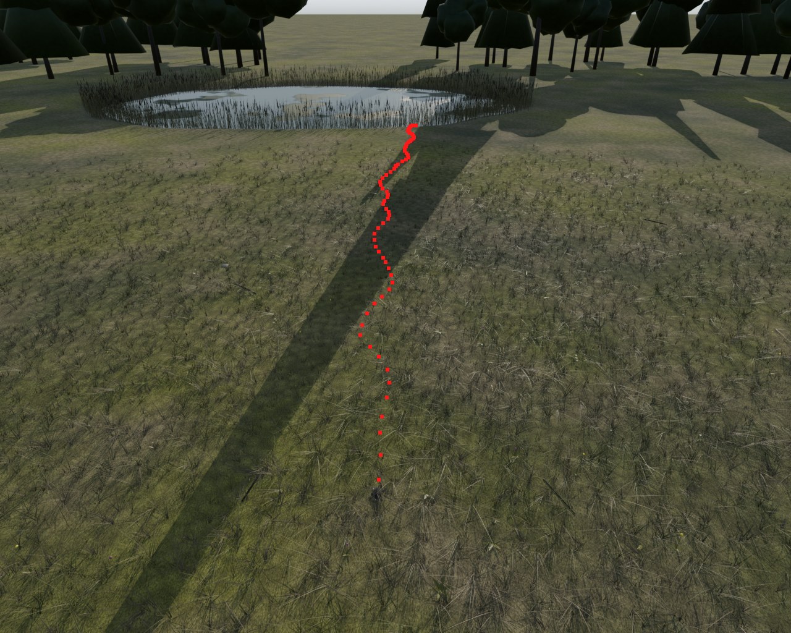
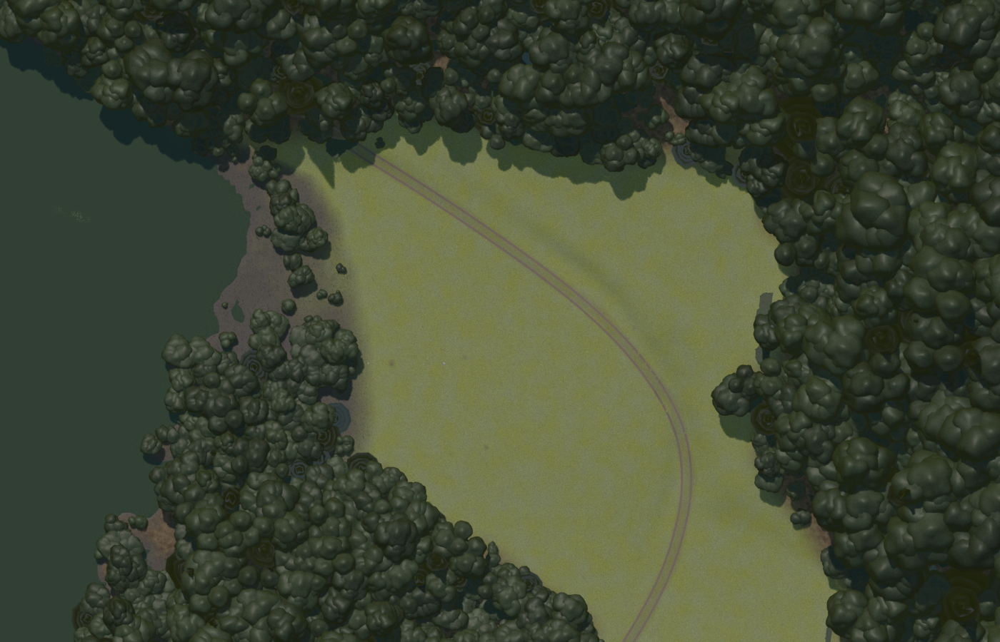

# Simulacije posnetkov sklednic

Sintetični podatki za učenje modela, ki prepozna želvo (močvirsko sklednico) na travniku.
Blender scena + Python skripta generirata **RGB in termalne slike** z oznakami, ter **animacije**,
kjer želva priplava iz mlake in gre čez travnik proti kameri.



## Scena

Scena je narejena po **pravem bajerju in travniku** (45.94005 N, 14.55201 E) iz odprtih LiDAR podatkov ARSO:



- **Teren**: digitalni model reliefa DMR 1 m (z blagim hribčkom in brežino ob kolovozu), okno 240 × 240 m.
- **Mlaka** na zahodu: oblika iz LiDAR (voda ne vrne odboja + gladina), poglobljeno dno, **lokvanji**, trst ob obali.
- **Drevesa** (~1900) na pravih mestih in v pravih višinah – vrhovi krošenj iz oblaka točk (GKOT), + grmovje.
- **Travnik** samo tam, kjer ga pokaže LiDAR (v gozdu so tla z listjem in mahom).
- **Kolovoz** z dvema kolesnicama po trasi s satelitskega posnetka.
- **Fiksna kamera** na sredini travnika, 5 m nad tlemi, nagib 62°, gleda proti mlaki (24 mm).
- **Trava** je večinoma proceduralna tekstura + redki 3D šopi blizu kamere.
- **Želva**: 3D model, dolžina 15–25 cm, oklep s ščitki in rumenimi pikami, glava/noge iztegnjene ali skrite.
- Motilci: kamni (na soncu topli – dobri lažni pozitivi), krtine, veje.

Koordinate: (0, 0) = zgornja točka (D96/TM E=465263.6, N=89011.0), x proti vzhodu, y proti severu, metri.

Pri vsaki sliki/animaciji se naključno spremenijo: položaj in barva želve, barve trave, zemlje, gozdnih tal,
vode, lokvanjev in dreves, suhost, gole krpe, smer polegnjenosti trave, sonce/oblačnost, rekviziti in temperature.

### LiDAR podatki

V repozitoriju je že pripravljena `lidar/site_scene.npz`. Za ponovno izdelavo (npr. drugo lokacijo):

```bash
cd lidar
curl -O http://gis.arso.gov.si/lidar/dmr1/b_35/D96TM/TM1_465_89.asc
curl -O http://gis.arso.gov.si/lidar/dmr1/b_35/D96TM/TM1_465_88.asc
curl -O http://gis.arso.gov.si/lidar/gkot/laz/b_35/D96TM/TM_465_89.laz
curl -O http://gis.arso.gov.si/lidar/gkot/laz/b_35/D96TM/TM_465_88.laz
pip install "laspy[lazrs]" numpy
python process_lidar.py      # -> site.npz (teren, višina rastlinja, voda)
python make_site.py          # -> site_scene.npz (mlaka, travnik, drevesa, grmi, kolovoz)
```

Nato znova zgradi sceno (`--build`, glej spodaj).

## Zahteve

- **Blender 4.2+** (testirano na Blender 5.0.1), EEVEE, GPU.
- Ni drugih odvisnosti (numpy je del Blenderja, video se kodira prek Blenderja – ffmpeg ni potreben).

V ukazih spodaj je `blender` pot do Blenderja, npr. `"C:\Program Files\Blender Foundation\Blender 5.0\blender.exe"`.

## 1) Posamezne slike (dataset)

```bash
blender -b turtle_meadow.blend -P turtle_dataset.py -- --render 1000 --out dataset
```

Dodatno: `--seed 7`, `--start 1000` (nadaljuj številčenje), `--cycles`.
Hitrost: ~6 s na sliko (RGB 1280×1024 + termalna 640×512 + maska).

**Ime datoteke = koordinate želve** v metrih: `x+12.135_y-6.025_00003.png` (+ zaporedna številka).

| mapa | vsebina |
|---|---|
| `rgb/` | normalna slika 1280×1024 |
| `thermal/` | termalna slika 640×512, 8-bit sivinska (white-hot) |
| `mask/`, `mask_thermal/` | segmentacijska maska vidnega dela želve (RGB / termalna) |
| `combined/` | RGB + termalna ena ob drugi (za pregled) |
| `labels/`, `labels_thermal/` | YOLO oznaka `0 cx cy w h` (normalizirano) za RGB in termalno kamero |
| `meta/` | JSON: svetovne koordinate želve, kamera, bbox, vsi parametri in temperature |
| `annotations.csv` | povzetek vseh slik |

Primeri: [`primeri/slike`](primeri/slike).

## 2) Animacija: želva pride iz mlake

```bash
blender -b turtle_meadow.blend -P turtle_dataset.py -- --animate --seed 1 --out animations
```

- Vsak video ima svoje naključno okolje (trava, gole krpe, sonce, nebo, rekviziti …).
- Želva vedno začne v mlaki na naključnem delu vidne obale, priplava ven in gre po naključni poti
  (0–2 vmesni točki, vijuganje, spreminjanje hitrosti, postanki) na naključno mesto na travniku 3,5–22 m od kamere.
- Realna hitrost ~0,08–0,18 m/s (vsakič drugačna) → posnetek je dolg 3–8 minut.
- V termalni sliki pride iz vode hladnejša in se na soncu postopno segreva.
- Izhod v `animations/anim_0001/`: `rgb.mp4`, `thermal.mp4`, `combined.mp4`,
  `track.csv` (položaj, hitrost, stanje, bbox in temperatura želve za vsako sličico), `info.json`,
  `pot.png` (okolje z vrisano potjo), `scene.blend` (animirana scena za ogled v Blenderju)
  in `frames/` s posameznimi sličicami (`rgb/`, `thermal/`, `mask/`, `combined/`, `labels/` YOLO).
- Med renderjem terminal za vsako sličico izpiše, koliko časa je porabil render termalne in RGB slike,
  zapis datotek, skupaj in oceno do konca.

Možnosti:

| zastavica | pomen |
|---|---|
| `--fps 10` | sličice na sekundo (privzeto 10) |
| `--low` | nizka kvaliteta za hiter test (RGB 640×512, manj vzorcev) |
| `--stop-dist 5` | kako daleč od kamere (m) se želva ustavi |
| `--no-frames` | ne shrani posameznih sličic (privzeto se shranijo poleg videa) |
| `--preview 10` | simulira celo pot, zrenderira samo 10 sličic (brez videa) – za hiter pregled poti |

Primer predogleda poti: [`primeri/pot_zelve`](primeri/pot_zelve).

**Hitrost renderja:** ozadje se zrenderira samo enkrat, nato pa za vsako sličico samo majhen izsek
okoli želve in njene sence (Render Region), ki se zmeša na ozadje (samo spremenjeni piksli – brez vidnih robov).
Rastlinje se pred animacijo "zapeče", maska je v B kanalu termalnega renderja.
Približno 0,8 s/sličico (polna kvaliteta) oz. 0,45 s/sličico (`--low`).

## Zavihek „Želva" v Blenderju (najlažji način)

Odpri `turtle_meadow.blend` v Blenderju. Ob prvem odprtju Blender pokaže opozorilo o skriptah – klikni
**Allow Execution** (ali enkrat vklopi *Preferences → Save & Load → Auto Run Python Scripts*).
Na vrhu se pojavi zavihek **Želva** (poleg Layout, Modeling …): pogled skozi kamero in desno vse nastavitve
(isti zavihek je tudi v stranski vrstici vsakega 3D pogleda, tipka `N`).

- **Render**: *Ena slika*, *Ena animacija*, *Predogled poti* (N sličic, brez videa), *Paket* (N slik ali
  animacij z naključnimi semeni), *Nov naključen primer v pogledu* (brez renderja), *Odpri mapo z rezultati*.
  Seme je naključno ali izbrano.
- **Kameri**: ločljivost, goriščnica in širina senzorja RGB in termalne kamere, zamik termalne leče.
  Sproti pokaže vidni kot in ali je kader enak (skupne oznake) ali različen (ločene: `labels/` in `labels_thermal/`).
- **Želva**: dolžina min/max, največja oddaljenost od kamere, verjetnost ob mlaki, najmanj vidnih pikslov,
  delež slik brez želve.
- **Termalno**: za koliko °C je želva toplejša od trave (min/max), temperatura zraka, šum kamere, AGC,
  ali pride iz vode ohlajena in kako hitro se segreje.
- **Okolje**: verjetnost oblačnosti, višina sonca, višina trave, gostota 3D šopov.
- **Animacija**: fps, hitrost želve, postanki, kako daleč od kamere se ustavi, vmesne točke.
- **Kakovost in izhod**: nizka kakovost (hiter test), vzorci, shranjevanje sličic, mapa za rezultate
  (privzeto `rezultati/` poleg `.blend`).

Med renderjem zavihek kaže napredek in čas do konca; **Ustavi** (ali Esc) prekine. Render teče v istem
Blenderju (3D pogled se med tem preklopi v Solid) – vmes ne delaj drugega. Nastavitve se shranijo v `.blend`
(ne pozabi shraniti) in jih uporabljajo tudi ukazi iz terminala.

Če `turtle_dataset.py` spremeniš ali imaš `.blend` brez zavihka:
```bash
blender -b turtle_meadow.blend -P turtle_dataset.py -- --install-ui
```

## Svoja kamera (premik v Blenderju)

1. Odpri `turtle_meadow.blend`, izberi kamero `TD_Camera` in jo premakni/zasukaj na mesto, kjer boste
   dejansko snemali (goriščnica in ločljivost sta v zavihku Želva → Kameri). Pogled skozi kamero: `Numpad 0`.
2. Shrani `.blend` (mapa `lidar/` mora ostati poleg).
3. Renderiraj kot običajno (`--render`, `--animate`, `--preview`). Skripta zazna, da je kamera premaknjena,
   in je **ne ponastavi**. Šopi trave se raztrosijo okoli novega kadra, poti želve in naključni položaji
   se izračunajo za tvojo kamero (cilj je vedno v kadru, 3,5–22 m od kamere). Če kamera ne vidi obale,
   želva pride iz vode na najbližji obali in prileze v kader.
4. **Ne poganjaj `--build`**, ker sceno zgradi na novo in kamero vrne na privzeto mesto.

Med animacijo terminal izpiše, katera kamera je uporabljena ter dolžino poti in posnetka.

## Nastavitve

Na vrhu `turtle_dataset.py`: velikost travnika, mlaka, ločljivosti, položaj in nagib kamere,
velikost želve, gostota 3D šopov, delež slik brez želve (`NEGATIVE_PROB`), parametri animacije (`ANIM_*`) …

Scena se zgradi znova z:

```bash
blender -b -P turtle_dataset.py -- --build --blend turtle_meadow.blend
```

Zagon skripte iz Blenderjevega Text Editorja (v `.blend` je vgrajena) postavi nov naključen primer za ogled.
